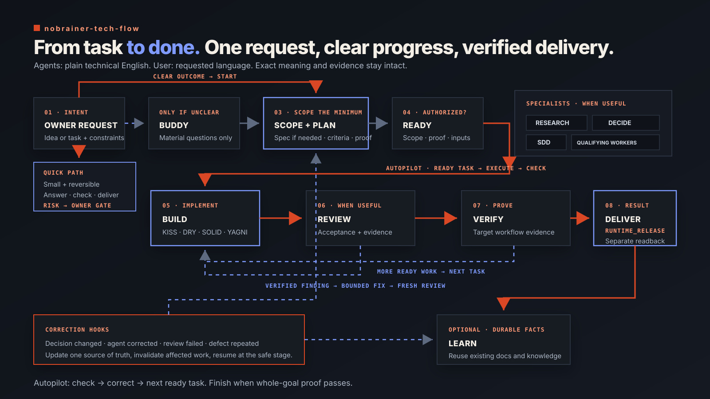
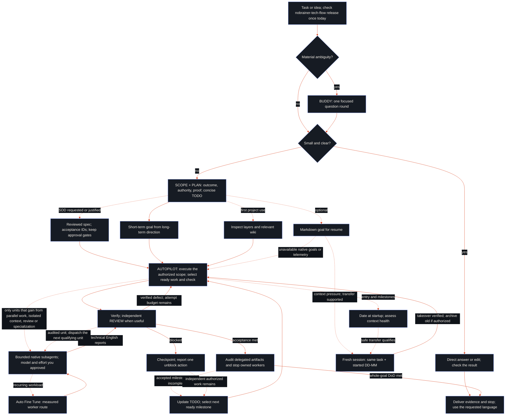

<p align="center">
  <a href="https://nobrainer.tech">
    
  </a>
</p>

<h1 align="center">nobrainer-tech-flow</h1>

<p align="center">
  <strong>From task to done. See what was delivered.</strong><br>
  For developers whose coding agent said "Done." without proof.
</p>

<p align="center">
  Make your coding agent prove "done". Flow checks the claim against the evidence,
  answers <code>NOT_DONE</code> when the test log disagrees, and ends each task with a handoff:
  what was delivered, what was checked and what was not.<br>
  One workflow with 18 modules for the whole <a href="#the-ai-native-sdlc-in-one-workflow">AI-native SDLC</a>,
  in Claude Code, Codex, Cursor and five more coding agents. Free, MIT.
</p>

<p align="center">
  <a href="https://github.com/nobrainer-tech/nobrainer-tech-flow/stargazers"></a>
  <a href="https://github.com/nobrainer-tech/nobrainer-tech-flow/releases/latest"></a>
  <a href="https://github.com/nobrainer-tech/nobrainer-tech-flow/actions/workflows/validate.yml"></a>
  <a href="LICENSE"></a>
</p>

**Try it in 60 seconds, nothing to install.** Add the free remote MCP server: no sign-in,
six read-only tools, it stores nothing. In Claude Code:

```sh
claude mcp add --transport http nobrainer-tech-flow https://mcp.nobrainer.tech/mcp
```

In Codex: `codex mcp add nobrainer-tech-flow --url https://mcp.nobrainer.tech/mcp`.
Cursor, VS Code, ChatGPT and other clients: [setup steps](mcp/README.md#install) (verified so
far in Claude Code, Codex CLI and OpenCode). Then give your agent a task with a checkable result:

> Use NoBrainer Tech Flow. Fix the failing test in this project. Done means the test suite passes.

**Install all 18 modules** (Node 18+ and Python 3.11+). The first command only previews:

```sh
npx nobrainer-tech-flow --client claude           # preview: changes nothing
npx nobrainer-tech-flow --client claude --apply   # install
```

`--client` is `claude`, `codex`, `opencode` or `copilot`; undo with `--undo --apply`.
Plugins for Claude Code and Codex, and a Git install for any agent: [Install safely](#install-safely).

<p align="center">
  <picture>
    <source media="(max-width: 600px)" srcset="assets/done-gate-demo-narrow.svg">
    
  </picture><br>
  <sub>The agent claims the tests pass; the log says <code>1 failed</code>. The done gate rejects the claim until a real passing run arrives.
  Live calls to <code>mcp.nobrainer.tech</code>, rebuilt by <a href="docs/demo/done_gate_demo.py"><code>docs/demo/done_gate_demo.py</code></a> from the <a href="docs/demo/done-gate-transcript.json">recorded transcript</a>.</sub>
</p>

**Before and after.** Without Flow, the agent's last message is its word:

```text
Fixed the date parser. All tests pass. Done.
```

With Flow, the task ends with the handoff the server drafts from its done receipt, filled in by the agent (shortened):

```text
## Delivered
parse('2026-02-30') now raises ValueError.
## Proof
- AC01 test, local, accepted (digest 13848f53): pytest -q, 5 passed
## Not checked
- Nothing
Evidence was reported by the agent; the server checked consistency, not truth.
```

<p align="center">
  <a href="https://youtu.be/OflTMvq_Pww"></a><br>
  <sub>▶ <a href="https://youtu.be/OflTMvq_Pww"><strong>PROVE IT</strong></a>: a song for every AI agent that says done. Flo &amp; MC P, Episode 1 (2 min, YouTube).</sub>
</p>

<p align="center">
  <a href="https://nobrainer.tech/flow/?nb_from=github-readme">Launch page</a> ·
  <a href="https://nobrainer.tech/flow/compare/?nb_from=github-readme">Compare 50+ tools</a> ·
  <a href="https://nobrainer.tech/flow/changelog/?nb_from=github-readme">Public verification notes</a> ·
  <a href="https://www.producthunt.com/products/nobrainer-tech-flow">Product Hunt</a>
</p>

## Where it runs

| Channel | Where |
|---|---|
| Coding agents, all 18 modules | [Claude Code](docs/INSTALL.md#claude-code) · [Codex](docs/INSTALL.md#codex) · [Cursor](docs/INSTALL.md#cursor) · [GitHub Copilot CLI](docs/INSTALL.md#github-copilot-cli-and-shared-agent-skills) · [Gemini CLI](docs/INSTALL.md#gemini-cli) · [OpenCode](docs/INSTALL.md#opencode) · [Kimi Code](docs/INSTALL.md#kimi-code) · [Pi](docs/INSTALL.md#pi) |
| Packages | [npm: `npx nobrainer-tech-flow`](https://www.npmjs.com/package/nobrainer-tech-flow) · [Claude and ChatGPT plugin ZIP](docs/CHAT_PLUGINS.md) · [Git install with preview and undo](#install-safely) |
| No install | [Free remote MCP server `mcp.nobrainer.tech/mcp`](mcp/README.md#install), any MCP client |

The MCP server is verified in Claude Code, Codex CLI and OpenCode. The
[MCP server README](mcp/README.md#install) has setup steps for Claude.ai, ChatGPT, Cursor,
VS Code / Copilot, Gemini CLI, Cline, Windsurf and Zed. These are not verified yet. What has been loaded
and tested in each coding agent is in the [compatibility evidence](docs/COMPATIBILITY.md).

## What it does

- **A handoff you can check.** Each finished task ends with `Delivered`, `Checked`
  (command and result) and `Not checked` (gap and reason). An optional evidence receipt marks a check `STALE` once
  its input files change.
- **Small tasks stay small.** A quick answer stays a quick answer; larger work gets one
  focused question round, a short TODO, execution and verification.
- **One main loop, workers only where they pay.** A part goes to a native worker only for
  parallel work, context isolation, independent review or specialization.
- **A pause before risky commands.** Optional Claude Code guards ask before
  `git push --force`, `git reset --hard`, a production deploy or a publish, and
  before an edit to a protected path, a credential or, in fix mode, a test.
- **Ideas and plans to delivery.** [SDD](skills/nobrainer-tech-flow/references/idea-to-delivery.md)
  turns an idea into checkable acceptance criteria;
  [autopilot](skills/nobrainer-tech-flow/references/autopilot.md) carries an approved plan
  through to the whole goal.

Free, MIT. The Git install previews every change and has undo. Your coding client's usage
costs still apply.

Only want the working rules? [NoBrainer Can-Do Approach](https://github.com/nobrainer-tech/can-do)
is one guide you can give any agent: complete the requested work, make routine decisions,
recover from failures and verify the result. Flow adds the scoping, coordination, review
and continuity around it.

## The AI-native SDLC in one workflow

Anthropic's [AI-native SDLC playbook](https://claude.com/resources/articles/the-ai-native-sdlc-playbook)
rebuilds plan, design, build, test, deploy and maintain around agents, with a
committed artifact at the end of every stage. nobrainer-tech-flow runs that loop
with the same eighteen modules and no extra service:

| Stage | What Flow commits or gates | Module |
|---|---|---|
| Plan | an intent record (problem, outcome, affected systems, constraints, open questions), accepted by merge | `nobrainer-tech-flow` |
| Design | a spec with `INTENT_REF`, acceptance IDs and a policy-review table routed to named owners | `nobrainer-spec-driven-development` |
| Build | a scope block with risks, one main loop, guards on risky commands and edits | `nobrainer-build`, `nobrainer-tech-flow` |
| Test | a proof line with real output, a standing scenario set, an eval-coverage check in CI | `nobrainer-review`, `nobrainer-browser` |
| Deploy | `REVIEW.md` passes with `IMPORTANT`/`NIT` labels, a PR Definition of Done with one status per gate, autonomy tiers by environment, owner gates | `nobrainer-review`, `nobrainer-security` |
| Maintain | one baseline metric, a deterministic detector, log / diagnose / propose bands, post-mortems that become evals | `nobrainer-rca`, `nobrainer-tech-flow` |

The [gap map](docs/evals/ai-native-sdlc-gap-map-2026-11-02.md) shows where each
play lives and what 2.10.0 added. It works the same in every coding agent listed
under [Where it runs](#where-it-runs).

## Install safely

Pick one channel. The first four install the same 18 modules.

**Claude Code** (plugin):

```sh
claude plugin marketplace add nobrainer-tech/nobrainer-tech-flow
claude plugin install nobrainer-tech-flow@nobrainer-tech
```

Then start with `/nobrainer-tech-flow:nobrainer-tech-flow` or say "Use nobrainer-tech-flow".

**Codex** (plugin):

```sh
codex plugin marketplace add nobrainer-tech/nobrainer-tech-flow
codex plugin add nobrainer-tech-flow@nobrainer-tech
```

Then start with `$nobrainer-tech-flow:nobrainer-tech-flow` or say "Use nobrainer-tech-flow".

**npm** (Node 18+ and Python 3.11+); `--client` is `codex`, `claude`, `opencode` or `copilot`:

```sh
npx nobrainer-tech-flow@2.12.0 --client codex            # preview: changes nothing
npx nobrainer-tech-flow@2.12.0 --client codex --apply    # install
npx nobrainer-tech-flow@2.12.0 --client codex --undo --apply
```

**Any coding agent** (Git install with preview and undo; macOS, Linux and Windows, no
Python needed). Paste this prompt into your agent; the same prompt installs and updates:

```text
Install nobrainer-tech-flow from https://github.com/nobrainer-tech/nobrainer-tech-flow
for the coding agent you are, or update it if it is already installed.

1. Keep a copy in ~/.nobrainer-tech-flow: clone the repository there, or run
   git pull there if it already exists. Do not delete that folder later; the
   skills link to it.
2. Read the install section of its README and follow the method it gives for
   your client and operating system (docs/INSTALL.md has the details).
3. Preview first and show me what will change. Apply only after I agree, and
   do not edit my files beyond what that method does.
4. Tell me the undo command, and whether I need to restart you.
```

Or run it yourself (on Windows, in Git Bash):

```sh
git clone https://github.com/nobrainer-tech/nobrainer-tech-flow ~/.nobrainer-tech-flow
sh ~/.nobrainer-tech-flow/scripts/install.sh --client claude           # preview: changes nothing
sh ~/.nobrainer-tech-flow/scripts/install.sh --client claude --apply   # link the skills, add the block
```

`--client` is `claude`, `codex`, `opencode` or `copilot`; undo with `--undo --apply`.
Cursor, Gemini CLI, Pi and Kimi Code use a plugin or extension:
[client channels](docs/INSTALL.md#client-channels). The installer adds one instruction
block that lets Flow update itself to verified stable releases once a day;
`install_personalization.py --no-auto-update` makes that a notification only. To pin a
reviewed commit, see [Safe default](docs/INSTALL.md#safe-default).

**MCP server, no install**: add `https://mcp.nobrainer.tech/mcp` (no sign-in, stateless).
In Claude Code:

```sh
claude mcp add --transport http nobrainer-tech-flow https://mcp.nobrainer.tech/mcp
```

Its six read-only tools give the agent a task contract, an evidence check, a done gate and
a model advisor. The done gate checks evidence consistency; it does not run your commands.
The server does not install the 18 modules. Other clients:
[MCP server README](mcp/README.md#install).

**First task.** In a fresh session, give it one small task with a checkable result:

> Use nobrainer-tech-flow. Fix one bug in this project. Reproduce it first, make the
> smallest correction and run the relevant check. Tell me what changed and
> what remains unverified.

More first tasks: [docs/TRY_IT.md](docs/TRY_IT.md).

## How it works



Small, clear tasks take the quick path. Larger work is scoped, carried through and
verified, with bounded corrective attempts, and the handoff says what is left for you to
decide. The full guide is in [How it works](docs/HOW_IT_WORKS.md).

<details>
<summary><strong>Workflow chart</strong></summary>



</details>

**Modules:** [`nobrainer-tech-flow`](skills/nobrainer-tech-flow/) (entrypoint) ·
[`nobrainer-auto-fine-tune`](skills/nobrainer-auto-fine-tune/) ·
[`nobrainer-context`](skills/nobrainer-context/) ·
[`nobrainer-skill-doctor`](skills/nobrainer-skill-doctor/) ·
[`nobrainer-team`](skills/nobrainer-team/) ·
[`nobrainer-dispatcher`](skills/nobrainer-dispatcher/) ·
[`nobrainer-research`](skills/nobrainer-research/) ·
[`nobrainer-writing`](skills/nobrainer-writing/) ·
[`nobrainer-build`](skills/nobrainer-build/) ·
[`nobrainer-security`](skills/nobrainer-security/) ·
[`nobrainer-sessions`](skills/nobrainer-sessions/) ·
[`nobrainer-spec-driven-development`](skills/nobrainer-spec-driven-development/) ·
[`nobrainer-wiki`](skills/nobrainer-wiki/) ·
[`nobrainer-browser`](skills/nobrainer-browser/) ·
[`nobrainer-autoimprove`](skills/nobrainer-autoimprove/) ·
[`nobrainer-decide`](skills/nobrainer-decide/) ·
[`nobrainer-rca`](skills/nobrainer-rca/) ·
[`nobrainer-review`](skills/nobrainer-review/).
What each one owns and its trigger aliases:
[skill table](docs/HOW_IT_WORKS.md#eighteen-skills-distinct-ownership).

## What's new in 2.12.0

Ask "find the implicit state machines in this module" and the review maps the fields that
together mean one state, proves each state nobody designed with a call sequence, and says
what to fix first; the fix goes to Build with a failing test first
([reference](skills/nobrainer-review/references/implicit-state.md)).

Also in this release: the copy tracked by the Claude plugin directory ships no script, as
the directory now requires (git and npm installs keep them), the plugin manifests pass the OpenAI
portal, `NOBRAINER_GUARD_STRICT=true` now turns strict mode on, and the MCP server sends a
stale check back for a rerun instead of to root-cause analysis and is described for the
official MCP Registry. Details: [release notes](RELEASE-NOTES.md).

## What's new in 2.11.0

Ask "give me the DoD for this PR" or "is this PR ready?" and Flow reports a pull request
Definition of Done: nine gates, one `VERIFIED`, `GAP`, `UNKNOWN` or `N/A` status per
check, one verdict and one next action, so green CI alone never counts as ready. Writing
adds formats for the task, PR description, commit and PR comments. Details:
[release notes](RELEASE-NOTES.md) and the
[gates](skills/nobrainer-review/references/pr-definition-of-done.md).

## What's new in 2.10.2

The MCP done gate now rejects PHPUnit runs with zero assertions when every test is marked risky.

## What's new in 2.10.1

The MCP done gate rejects a recognised failed test summary even if a later summary passes.
Submit a clean rerun separately to complete the criterion.

## What's new in 2.10.0

Flow now covers every stage of the AI-native SDLC playbook inside the same eighteen
skills: a committed intent record and a spec with `INTENT_REF` and policy owners;
`Risks:` in the scope block; guards that also watch edits to protected paths,
credential-looking content and test files during a fix, with a strict mode for
production deploys; a standing scenario set with an eval-coverage check in CI;
Review with `REVIEW.md` passes and `IMPORTANT`/`NIT` labels; autonomy tiers by
environment; and a closing-the-loop reference that turns one baseline metric into
diagnosis or a proposed PR. Sessions gains a transport contract and short-lived CLI
workers. Details: [release notes](RELEASE-NOTES.md) and the
[gap map](docs/evals/ai-native-sdlc-gap-map-2026-11-02.md).

## What's new in 2.9.3

The MCP done gate no longer counts Python unittest expected failures as passing tests.

## What's new in 2.9.2

The MCP done gate no longer treats shared-network IP addresses or reserved
`.invalid`, `.test` and `.example` names as production evidence.

## What's new in 2.9.1

The MCP done gate now reopens a test when a re-run fails without output. A later
passing result can mark the item done again.

## What's new in 2.9.0

Flow now carries a short work-to-done contract in its entry skill. A request to do
something is done, not answered with a plan; a question gets an answer and no unrequested
edits. The agent keeps every requirement you add mid-task, decides routine reversible
details itself, reuses permission you already gave, keeps working on independent parts
while one item waits, and prepares everything allowed before it asks for an approval.
Before it hands over, a finish check makes it perform any action its reply would only
promise, and forbids calling a partial result done. See the
[2.9.0 verification record](docs/releases/v2.9.0.md).

## What's new in 2.8.0

Every finished task now ends with the same three-part handoff: `Delivered`, `Checked`
(each command with its result) and `Not checked` (each gap with its reason). A validator
keeps that block in the skill. The done gate also asks the agent to list each place where
docs and code disagree. Each module description now starts with the situation it handles,
so you can find the right module by what you need. See the
[2.8.0 verification record](docs/releases/v2.8.0.md).

## What's new in 2.7.0

Before substantial work the agent shows what done means and sets it as the host's native
goal where one exists. Flow delegates only where it pays, records each of your requests in the
goal file as it arrives so compaction cannot drop it, and a security review needs a second
independent pass before it can report a clean result. Full notes:
[RELEASE-NOTES.md](RELEASE-NOTES.md) and the [2.7.0 verification record](docs/releases/v2.7.0.md).

## Documentation

| | |
|---|---|
| [Installation](docs/INSTALL.md) | Every channel, reviewed-commit install, guards, rollback |
| [Compatibility](docs/COMPATIBILITY.md) | What has been loaded and tested in each client |
| [Testing](docs/TESTING.md) | Acceptance evidence and how to run the checks |
| [How it works](docs/HOW_IT_WORKS.md) | Workflow, skills, learning loop, quality rules |
| [Release notes](RELEASE-NOTES.md) and [verification records](docs/releases/) | What changed and how each release was checked |
| [MCP server](mcp/README.md) | Remote server tools and per-client setup |
| [Chat plugins](docs/CHAT_PLUGINS.md) | Plugin ZIP for Claude and ChatGPT |
| [Migration](docs/MIGRATION_TO_FLOW.md) and [naming](docs/NAMING.md) | Moving from the previous `nobrainer-tech-skills` ID |

## Community

- [Run this as a ready workflow](https://nobrainer.tech/paths/ai-engineering/?nb_from=github-readme):
  from requirement to CI with a ready AI engineering workflow built on nobrainer-tech-flow.
- [New to AI? Start the free course](https://nobrainer.tech/edu/ai-basics/?nb_from=github-readme).
- If this workflow helps with a real task, star the repository and follow
  [@nobrainer_tech](https://x.com/nobrainer_tech) for build notes and practical examples.

Contributions: read [CONTRIBUTING.md](CONTRIBUTING.md) and [SECURITY.md](SECURITY.md).
`nobrainer-autoimprove` and `nobrainer-wiki` adapt Andrej Karpathy's
[autoresearch](https://github.com/karpathy/autoresearch) loop and
[LLM wiki concept](https://gist.github.com/karpathy/442a6bf555914893e9891c11519de94f).

NoBrainer.Tech builds practical agentic workflows for teams that want speed without
surrendering control. Learn more at [nobrainer.tech](https://nobrainer.tech) or browse
ready-to-use workflow products on [Gumroad](https://nobrainertech.gumroad.com).
