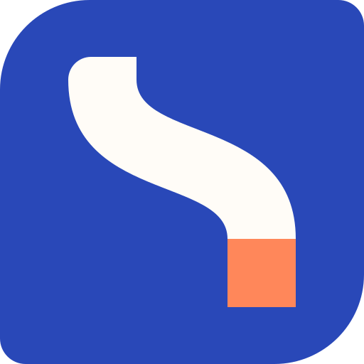
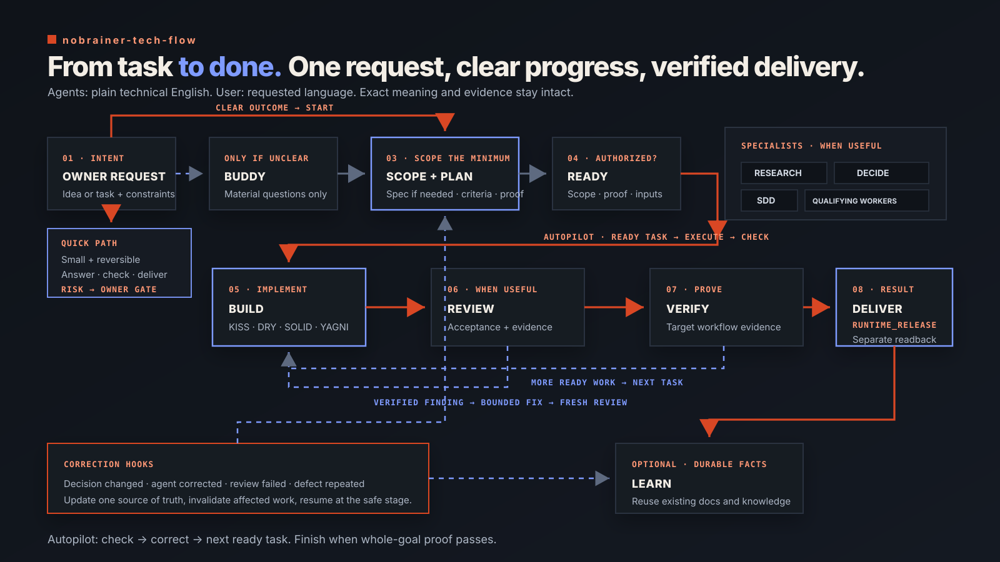
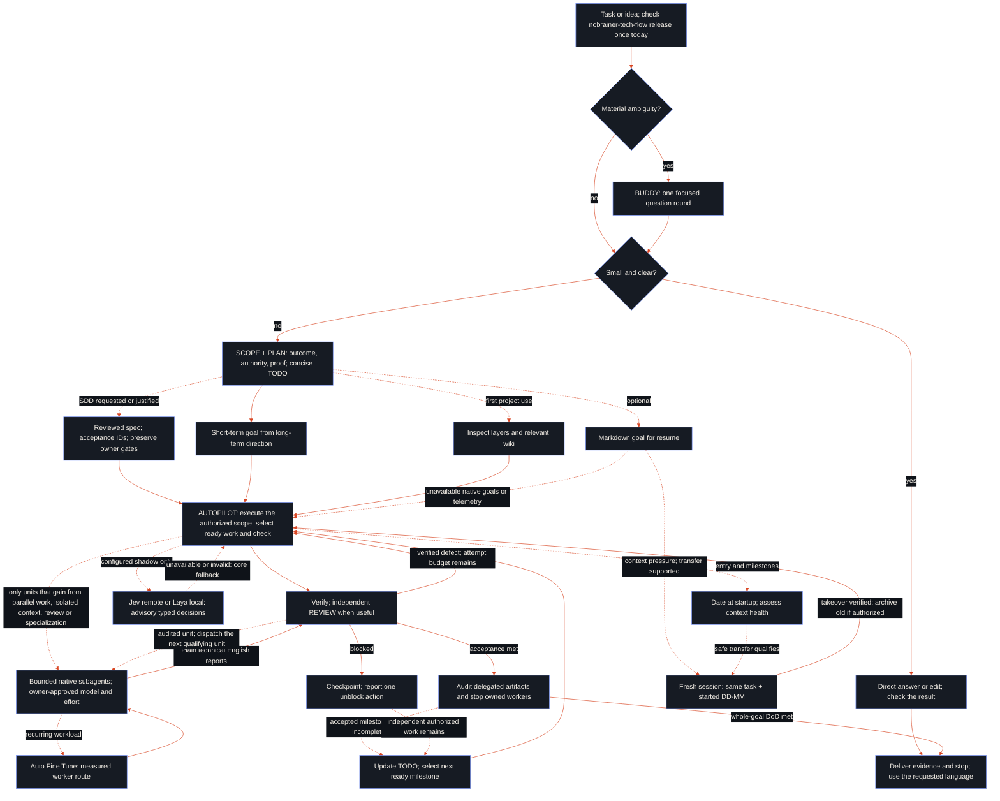

<p align="center">
  <a href="https://nobrainer.tech">
    
  </a>
</p>

<h1 align="center">nobrainer-tech-flow</h1>

<p align="center">
  <strong>From task to done. See what was delivered.</strong><br>
  For developers whose coding agent just said "Done."
</p>

<p align="center">
  <a href="https://youtu.be/OflTMvq_Pww"></a><br>
  <sub>▶ <a href="https://youtu.be/OflTMvq_Pww"><strong>PROVE IT</strong></a>: a song for every AI agent that says done. Flo &amp; MC P, Episode 1 (2 min, YouTube).</sub>
</p>

<p align="center">
  One workflow with 18 modules that lets your coding agent do the work, check it
  and hand over the evidence: what was delivered, what was checked and what was not.
</p>

<p align="center">
  <a href="https://github.com/nobrainer-tech/nobrainer-tech-flow/actions/workflows/validate.yml"></a>
  <a href="LICENSE"></a>
  <a href="https://github.com/nobrainer-tech/nobrainer-tech-flow/releases/latest"></a>
</p>

<p align="center">
  <a href="#install-safely"><strong>Install</strong></a> ·
  <a href="https://nobrainer.tech/flow/?nb_from=github-readme">Launch page</a> ·
  <a href="https://nobrainer.tech/flow/compare/?nb_from=github-readme">Compare 50+ tools</a> ·
  <a href="https://nobrainer.tech/flow/changelog/?nb_from=github-readme">Public verification notes</a> ·
  <a href="https://www.producthunt.com/products/nobrainer-tech-flow">Product Hunt</a>
</p>

## Where it runs

<p align="center"><sub><strong>Coding agents</strong>: all 18 modules</sub><br>
  <a href="docs/INSTALL.md#claude-code"></a>
  <a href="docs/INSTALL.md#codex"></a>
  <a href="docs/INSTALL.md#cursor"></a>
  <a href="docs/INSTALL.md#github-copilot-cli-and-shared-agent-skills"></a>
  <br>
  <a href="docs/INSTALL.md#gemini-cli"></a>
  <a href="docs/INSTALL.md#opencode"></a>
  <a href="docs/INSTALL.md#kimi-code"></a>
  <a href="docs/INSTALL.md#pi"></a>
</p>
<p align="center"><sub><strong>Packages</strong></sub><br>
  <a href="https://www.npmjs.com/package/nobrainer-tech-flow"></a>
  <a href="docs/CHAT_PLUGINS.md"></a>
  <a href="#install-safely"></a>
</p>
<p align="center"><sub><strong>No install</strong>: free remote MCP server, any MCP client</sub><br>
  <a href="mcp/README.md#install"></a>
</p>

The MCP server is verified in Claude Code, Codex CLI and OpenCode. Claude.ai, ChatGPT,
Cursor, VS Code / Copilot, Gemini CLI, Cline, Windsurf and Zed have setup steps in the
[MCP server README](mcp/README.md#install) and are not verified yet. What has been loaded
and tested in each coding agent is in the [compatibility evidence](docs/COMPATIBILITY.md).

## What it does

- **A handoff you can check.** Each finished task lists what was delivered, which checks
  ran and what was not checked. An optional evidence receipt marks a check `STALE` once
  its input files change.
- **Small tasks stay small.** A quick answer stays a quick answer; larger work gets one
  focused question round, a short TODO, execution and verification.
- **One main loop, workers only where they pay.** A part goes to a native worker only for
  parallel work, context isolation, independent review or specialization.
- **A pause before risky commands.** Optional Claude Code guards ask before
  `git push --force`, `git reset --hard`, a production deploy or a publish.
- **Ideas and plans to delivery.** [SDD](skills/nobrainer-tech-flow/references/idea-to-delivery.md)
  turns an idea into checkable acceptance criteria;
  [autopilot](skills/nobrainer-tech-flow/references/autopilot.md) carries an approved plan
  through to the whole goal.

Free, MIT. The Git install previews every change and has undo. Your coding client's usage
costs still apply.

## Install safely

Pick one channel. The first four install the same 18 modules.

**Claude Code** (plugin):

```sh
claude plugin marketplace add nobrainer-tech/nobrainer-tech-flow
claude plugin install nobrainer-tech-flow@nobrainer-tech
```

Then start with `/nobrainer-tech-flow:nobrainer-tech-flow` or say "Use nobrainer-tech-flow".

**Codex** (plugin):

```sh
codex plugin marketplace add nobrainer-tech/nobrainer-tech-flow
codex plugin add nobrainer-tech-flow@nobrainer-tech
```

Then start with `$nobrainer-tech-flow:nobrainer-tech-flow` or say "Use nobrainer-tech-flow".

**npm** (Node 18+ and Python 3.11+); `--client` is `codex`, `claude`, `opencode` or `copilot`:

```sh
npx nobrainer-tech-flow@2.7.2 --client codex            # preview: changes nothing
npx nobrainer-tech-flow@2.7.2 --client codex --apply    # install
npx nobrainer-tech-flow@2.7.2 --client codex --undo --apply
```

**Any coding agent** (Git install with preview and undo; macOS, Linux and Windows, no
Python needed). Paste this prompt into your agent; the same prompt installs and updates:

```text
Install nobrainer-tech-flow from https://github.com/nobrainer-tech/nobrainer-tech-flow
for the coding agent you are, or update it if it is already installed.

1. Keep a copy in ~/.nobrainer-tech-flow: clone the repository there, or run
   git pull there if it already exists. Do not delete that folder later; the
   skills link to it.
2. Read the install section of its README and follow the method it gives for
   your client and operating system (docs/INSTALL.md has the details).
3. Preview first and show me what will change. Apply only after I agree, and
   do not edit my files beyond what that method does.
4. Tell me the undo command, and whether I need to restart you.
```

Or run it yourself (on Windows, in Git Bash):

```sh
git clone https://github.com/nobrainer-tech/nobrainer-tech-flow ~/.nobrainer-tech-flow
sh ~/.nobrainer-tech-flow/scripts/install.sh --client claude           # preview: changes nothing
sh ~/.nobrainer-tech-flow/scripts/install.sh --client claude --apply   # link the skills, add the block
```

`--client` is `claude`, `codex`, `opencode` or `copilot`; undo with `--undo --apply`.
Cursor, Gemini CLI, Pi and Kimi Code use a plugin or extension:
[client channels](docs/INSTALL.md#client-channels). The installer adds one instruction
block that lets Flow update itself to verified stable releases once a day;
`install_personalization.py --no-auto-update` makes that a notification only. To pin a
reviewed commit, see [Safe default](docs/INSTALL.md#safe-default).

**MCP server, no install**: add `https://mcp.nobrainer.tech/mcp` (no sign-in, stateless).
In Claude Code:

```sh
claude mcp add --transport http nobrainer-tech-flow https://mcp.nobrainer.tech/mcp
```

Its six read-only tools give the agent a task contract, an evidence check, a done gate and
a model advisor; it does not install the 18 modules. Other clients:
[MCP server README](mcp/README.md#install).

**First task.** In a fresh session, give it one small task with a checkable result:

> Use nobrainer-tech-flow. Fix one bug in this project. Reproduce it first, make the
> smallest correction and run the relevant check. Tell me what changed and
> what remains unverified.

More first tasks: [docs/TRY_IT.md](docs/TRY_IT.md).

## How it works



Small, clear tasks take the quick path. Larger work is scoped, carried through and
verified, with bounded corrective attempts, and the handoff says what is left for you to
decide. The full guide is in [How it works](docs/HOW_IT_WORKS.md).

<details>
<summary><strong>Workflow chart</strong></summary>



</details>

**Modules:** [`nobrainer-tech-flow`](skills/nobrainer-tech-flow/) (entrypoint) ·
[`nobrainer-auto-fine-tune`](skills/nobrainer-auto-fine-tune/) ·
[`nobrainer-context`](skills/nobrainer-context/) ·
[`nobrainer-skill-doctor`](skills/nobrainer-skill-doctor/) ·
[`nobrainer-team`](skills/nobrainer-team/) ·
[`nobrainer-dispatcher`](skills/nobrainer-dispatcher/) ·
[`nobrainer-research`](skills/nobrainer-research/) ·
[`nobrainer-writing`](skills/nobrainer-writing/) ·
[`nobrainer-build`](skills/nobrainer-build/) ·
[`nobrainer-security`](skills/nobrainer-security/) ·
[`nobrainer-sessions`](skills/nobrainer-sessions/) ·
[`nobrainer-spec-driven-development`](skills/nobrainer-spec-driven-development/) ·
[`nobrainer-wiki`](skills/nobrainer-wiki/) ·
[`nobrainer-browser`](skills/nobrainer-browser/) ·
[`nobrainer-autoimprove`](skills/nobrainer-autoimprove/) ·
[`nobrainer-decide`](skills/nobrainer-decide/) ·
[`nobrainer-rca`](skills/nobrainer-rca/) ·
[`nobrainer-review`](skills/nobrainer-review/).
What each one owns and its trigger aliases:
[skill table](docs/HOW_IT_WORKS.md#eighteen-skills-distinct-ownership).

## What's new in 2.7.2

The plugin ZIP for plugin directories declares the optional remote MCP server in both the
Codex and the portable format and links its privacy policy; the Git marketplace and npm
installs stay skills-only. Skills do not change.
See the [2.7.2 verification record](docs/releases/v2.7.2.md).

## What's new in 2.7.0

Before substantial work the agent shows what done means and sets it as the host's native
goal where one exists. Flow delegates only where it pays, records each owner request in the
goal file as it arrives so compaction cannot drop it, and a security review needs a second
independent pass before it can report a clean result. Full notes:
[RELEASE-NOTES.md](RELEASE-NOTES.md) and the [2.7.0 verification record](docs/releases/v2.7.0.md).

## Documentation

| | |
|---|---|
| [Installation](docs/INSTALL.md) | Every channel, reviewed-commit install, guards, rollback |
| [Compatibility](docs/COMPATIBILITY.md) | What has been loaded and tested in each client |
| [Testing](docs/TESTING.md) | Acceptance evidence and how to run the checks |
| [How it works](docs/HOW_IT_WORKS.md) | Workflow, skills, learning loop, quality rules |
| [Release notes](RELEASE-NOTES.md) and [verification records](docs/releases/) | What changed and how each release was checked |
| [MCP server](mcp/README.md) | Remote server tools and per-client setup |
| [Chat plugins](docs/CHAT_PLUGINS.md) | Plugin ZIP for Claude and ChatGPT |
| [Migration](docs/MIGRATION_TO_FLOW.md) and [naming](docs/NAMING.md) | Moving from the previous `nobrainer-tech-skills` ID |

## Community

- [Run this as a ready workflow](https://nobrainer.tech/paths/ai-engineering/?nb_from=github-readme):
  from requirement to CI with a ready AI engineering workflow built on nobrainer-tech-flow.
- [New to AI? Start the free course](https://nobrainer.tech/edu/ai-basics/?nb_from=github-readme).
- If this workflow helps with a real task, star the repository and follow
  [@nobrainer_tech](https://x.com/nobrainer_tech) for build notes and practical examples.

Contributions: read [CONTRIBUTING.md](CONTRIBUTING.md) and [SECURITY.md](SECURITY.md).
`nobrainer-autoimprove` and `nobrainer-wiki` adapt Andrej Karpathy's
[autoresearch](https://github.com/karpathy/autoresearch) loop and
[LLM wiki concept](https://gist.github.com/karpathy/442a6bf555914893e9891c11519de94f).

NoBrainer.Tech builds practical agentic workflows for teams that want speed without
surrendering control. Learn more at [nobrainer.tech](https://nobrainer.tech) or browse
ready-to-use workflow products on [Gumroad](https://nobrainertech.gumroad.com).
